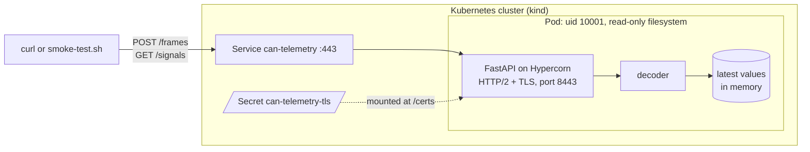
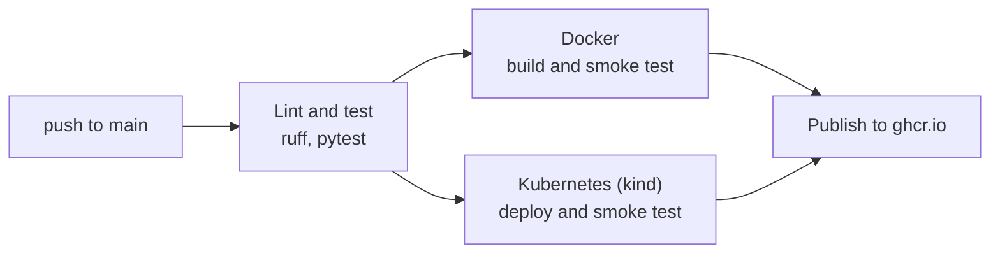

# CAN Telemetry API

[](https://github.com/Sana8200/can-telemetry-api/actions/workflows/ci.yml)

Decodes CAN bus frames into real values (rpm, °C, volts, amps) and serves the latest value of each signal over a REST API. It runs over HTTPS with HTTP/2, using certs from a private CA, in a small non-root container. CI lints and tests every push, then builds the image and smoke-tests it over HTTPS, both in Docker and on a kind cluster.

The CAN messages are made up for this project, they're not from a real car.

## How it fits together



## Running it

Need Docker and OpenSSL.

```bash
bash scripts/make-certs.sh
docker build -t can-telemetry-api .
docker run --rm -p 8443:8443 --user "$(id -u):$(id -g)" \
  -v "$PWD/certs:/certs:ro" \
  -e TLS_CERT_FILE=/certs/server.crt -e TLS_KEY_FILE=/certs/server.key \
  can-telemetry-api
```

Then from another terminal:

```bash
curl --cacert certs/ca.crt -X POST https://localhost:8443/frames \
  -H "Content-Type: application/json" \
  -d '{"frames": [{"id": 256, "data": "B80B695A00000000"}]}'
curl --cacert certs/ca.crt https://localhost:8443/signals/motor_rpm
```

You should get something like:

```json
{"decoded":1,"ignored":0}
{"name":"motor_rpm","message":"inverter","value":3000.0,"unit":"rpm","timestamp":1792589865.4}
```

`bash scripts/smoke-test.sh` does the same checks CI does (HTTP/2, the cert, posting a frame and reading it back).

## TLS

`scripts/make-certs.sh` makes a private CA and a server cert signed by it. The cert covers `localhost` and the Kubernetes service names, so the same one works in the cluster too. Clients just need to trust `ca.crt`. HTTP/2 is negotiated during the TLS handshake (ALPN).

The keys aren't in git or in the image, the container gets them from a read-only mount.

## API

| Method | Path | |
|---|---|---|
| `POST` | `/frames` | Decode and store a batch of frames (max 1000). Unknown IDs are counted as `ignored`. If any frame is bad, the whole batch gets a 422 and nothing is stored. |
| `GET` | `/signals` | Latest value of every signal seen so far |
| `GET` | `/signals/{name}` | Latest value of one signal. 404 if the name doesn't exist or nothing has come in yet |
| `GET` | `/messages` | Message and signal definitions |
| `GET` | `/healthz`, `/readyz` | Health checks |

Each frame has an `id` (11 or 29 bit), `data` (hex, up to 8 bytes) and an optional `timestamp` in unix time. Without one, the arrival time is used. An older frame won't overwrite a newer value.

## Signals

Everything is little-endian, and value = raw * scale + offset.

| ID | Message | Signal | Start bit | Length | Scale | Offset | Unit | Signed |
|---|---|---|---|---|---|---|---|---|
| 0x100 | inverter | motor_rpm | 0 | 16 | 1 | 0 | rpm | no |
| 0x100 | inverter | motor_temp | 16 | 8 | 1 | -40 | degC | no |
| 0x100 | inverter | inverter_temp | 24 | 8 | 1 | -40 | degC | no |
| 0x200 | battery | pack_voltage | 0 | 16 | 0.1 | 0 | V | no |
| 0x200 | battery | pack_current | 16 | 16 | 0.1 | 0 | A | yes |
| 0x200 | battery | state_of_charge | 32 | 8 | 0.5 | 0 | % | no |
| 0x300 | vehicle | speed | 0 | 16 | 0.01 | 0 | km/h | no |
| 0x300 | vehicle | throttle | 16 | 8 | 0.5 | 0 | % | no |

## Development

Python 3.12+.

```bash
git clone https://github.com/Sana8200/can-telemetry-api.git
cd can-telemetry-api
python3 -m venv .venv
source .venv/bin/activate
pip install -r requirements-dev.txt
pytest
ruff check .
hypercorn app.main:app --reload
```

The last one starts a dev server on http://localhost:8000 that reloads when you change the code. API docs are at http://localhost:8000/docs.

To run it with TLS without Docker:

```bash
TLS_CERT_FILE=certs/server.crt TLS_KEY_FILE=certs/server.key python -m app
```

## Kubernetes

Runs on a local [kind](https://kind.sigs.k8s.io/) cluster. Need kind and kubectl.

```bash
kind create cluster --name can-telemetry
bash scripts/make-certs.sh
docker build -t can-telemetry-api:dev .
kind load docker-image can-telemetry-api:dev --name can-telemetry
kubectl create secret tls can-telemetry-tls --cert=certs/server.crt --key=certs/server.key
kubectl apply -f k8s/
kubectl rollout status deployment/can-telemetry
kubectl port-forward service/can-telemetry 8443:443
```

Then `bash scripts/smoke-test.sh` from another terminal.

The pod runs as uid 10001 with a read-only filesystem, no Linux capabilities and no service account token. The cert and key come from a Secret, mounted read-only with mode 0440. Readiness and liveness probes hit `/readyz` and `/healthz` over HTTPS. There's one replica on purpose, since the latest values live in memory.

`kind delete cluster --name can-telemetry` removes the cluster.

## CI/CD



Every push to main runs this pipeline. The image is published only if both smoke tests pass, tagged with the short commit SHA and `latest`:

```bash
docker pull ghcr.io/sana8200/can-telemetry-api:latest
```

It's built for amd64, so on Apple silicon add `--platform linux/amd64`.

## Layout

```
app/
  signals.py          message/signal definitions
  can_decode.py       decoding
  store.py            latest value of each signal
  main.py             the API (FastAPI)
  __main__.py         python -m app, sets up TLS and shutdown
tests/
scripts/
  make-certs.sh       dev CA + server cert
  smoke-test.sh       checks a running server
k8s/
  deployment.yaml
  service.yaml
Dockerfile
.github/workflows/ci.yml
```

## Design notes

- **HTTP/2 over TLS.** The server offers `h2` during the TLS handshake (ALPN), with a certificate from a private CA.
- **Newest timestamp wins.** A late or out-of-order frame never overwrites a newer value.
- **All-or-nothing batches.** Every frame is checked and decoded before anything is stored, so one bad frame rejects the whole batch.
- **Timestamp range check.** Timestamps must be finite, not negative, and at most 60 s in the future. A NaN or far-future timestamp would otherwise block newer values.
- **Graceful shutdown.** On SIGTERM, which Kubernetes sends before stopping a pod, the server lets open requests finish and exits.
- **Keys never in git or the image.** They're mounted when the container starts: a read-only volume in Docker, a Secret in Kubernetes.

## Limitations

- The latest values live in memory: one replica, and a restart loses them. Scaling out would need a shared store such as Redis.
- Classic CAN only (up to 8 data bytes) and little-endian signals. No CAN FD or big-endian (Motorola) signals.
- No authentication yet. Mutual TLS, with client certificates from the same CA, would fit.
- No metrics yet.

## Roadmap

- [x] Decode CAN frames into physical signals, with tests
- [x] Lint and test every push with GitHub Actions
- [x] REST API with FastAPI and a thread-safe store of the latest values
- [x] Slim, non-root container image, built and smoke-tested in CI
- [x] HTTP/2 over TLS with certificates from a private CA
- [x] Deployment to Kubernetes (kind) with a locked-down pod
- [x] Image published to GitHub Container Registry
- [ ] Driving simulator and `candump -L` log upload