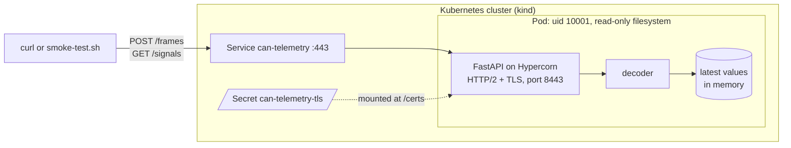
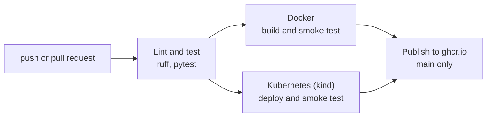

# CAN Telemetry API

[](https://github.com/Sana8200/can-telemetry-api/actions/workflows/ci.yml)

A small service that decodes CAN bus frames into real values (rpm, °C, volts, amps) and keeps the latest value of each signal, so you can read it back over a REST API.

It serves HTTPS with HTTP/2 using certificates from a private CA, and runs in a small non-root container. Every push and pull request is linted and tested, and the image is smoke-tested over HTTPS both in Docker and on a kind Kubernetes cluster. Builds from `main` are published to GitHub Container Registry.

The CAN messages are made up for this project. They don't come from a real car.

## How it fits together

Clients post raw frames to `/frames`. The decoder turns each frame into signal values, and the store keeps the newest value of each signal in memory, ready to be read from `/signals`.



## Quick start

You'll need Docker and OpenSSL.

```bash
bash scripts/make-certs.sh
docker build -t can-telemetry-api .
docker run --rm -p 8443:8443 --user "$(id -u):$(id -g)" \
  -v "$PWD/certs:/certs:ro" \
  -e TLS_CERT_FILE=/certs/server.crt -e TLS_KEY_FILE=/certs/server.key \
  can-telemetry-api
```

The first command creates a dev CA and a server certificate in `certs/`. The `--user` flag runs the container as you, because `server.key` is only readable by your user.

In a second terminal, send a frame and read one of its signals back:

```bash
curl --cacert certs/ca.crt -X POST https://localhost:8443/frames \
  -H "Content-Type: application/json" \
  -d '{"frames": [{"id": 256, "data": "B80B695A00000000"}]}'

curl --cacert certs/ca.crt https://localhost:8443/signals/motor_rpm
```

You should see something like:

```json
{"decoded":1,"ignored":0}
{"name":"motor_rpm","message":"inverter","value":3000.0,"unit":"rpm","timestamp":1792589865.4}
```

ID 256 is `0x100`, the inverter message. [Signals](#signals) shows how those 8 bytes turn into 3000 rpm.

`bash scripts/smoke-test.sh` runs the same checks as CI. It makes sure the server answers over HTTP/2 with a certificate that verifies against `ca.crt`, then posts a frame and reads it back.

## API

| Method | Path | What it does |
|---|---|---|
| `POST` | `/frames` | Decodes and stores a batch of up to 1000 frames. Frames with an unknown ID are skipped and counted as `ignored`. If any frame is invalid, the whole batch is rejected with a 422 and nothing is stored. |
| `GET` | `/signals` | Latest value of every signal received so far |
| `GET` | `/signals/{name}` | Latest value of one signal. Returns 404 if the signal doesn't exist or has no value yet. |
| `GET` | `/messages` | The message and signal definitions the decoder uses |
| `GET` | `/healthz`, `/readyz` | Liveness and readiness checks |

Each frame has:

- `id`: the CAN ID, 11 or 29 bits
- `data`: the payload as hex, up to 8 bytes. A known ID must have exactly the length its message defines (8 bytes for every message here).
- `timestamp` (optional): unix time in seconds. If it's missing, the time the frame arrived is used.

A frame with an older timestamp never overwrites a newer value.

## Signals

All signals are little-endian (Intel byte order), and the physical value is `raw * scale + offset`. Start bit 0 is the lowest bit of the first byte.

| ID | Message | Signal | Start bit | Length | Scale | Offset | Unit | Signed |
|---|---|---|---|---|---|---|---|---|
| 0x100 | inverter | motor_rpm | 0 | 16 | 1 | 0 | rpm | no |
| 0x100 | inverter | motor_temp | 16 | 8 | 1 | -40 | degC | no |
| 0x100 | inverter | inverter_temp | 24 | 8 | 1 | -40 | degC | no |
| 0x200 | battery | pack_voltage | 0 | 16 | 0.1 | 0 | V | no |
| 0x200 | battery | pack_current | 16 | 16 | 0.1 | 0 | A | yes |
| 0x200 | battery | state_of_charge | 32 | 8 | 0.5 | 0 | % | no |
| 0x300 | vehicle | speed | 0 | 16 | 0.01 | 0 | km/h | no |
| 0x300 | vehicle | throttle | 16 | 8 | 0.5 | 0 | % | no |

For example, the inverter frame from the quick start, `B8 0B 69 5A 00 00 00 00`, decodes like this:

- `motor_rpm`: bytes 0 and 1, read little-endian, are `0x0BB8` = 3000, so 3000 rpm
- `motor_temp`: byte 2 is `0x69` = 105, and 105 - 40 = 65 °C
- `inverter_temp`: byte 3 is `0x5A` = 90, and 90 - 40 = 50 °C

## Configuration

The server is configured with environment variables:

| Variable | Default | |
|---|---|---|
| `TLS_CERT_FILE`, `TLS_KEY_FILE` | not set | Paths to the server certificate and key. Set both to serve HTTPS with HTTP/2, or neither for plain HTTP. Setting only one is an error. |
| `PORT` | 8443 with TLS, 8080 without | Port to listen on |

## Certificates

`scripts/make-certs.sh` creates a private CA and a server certificate signed by it. The certificate covers `localhost`, `127.0.0.1` and the Kubernetes service names, so the same one works locally and in the cluster. Clients only need to trust `certs/ca.crt`. HTTP/2 is agreed on during the TLS handshake, through ALPN.

The certificates are for development only and expire after a year. Run the script again to make new ones.

The keys never go into git or the image. The container reads them from a read-only mount: a volume in Docker, a Secret in Kubernetes.

## Local development

You'll need Python 3.12 or newer.

```bash
git clone https://github.com/Sana8200/can-telemetry-api.git
cd can-telemetry-api
python3 -m venv .venv
source .venv/bin/activate
pip install -r requirements-dev.txt
```

Run the tests and the same lint and format checks as CI (`ruff format .` fixes formatting):

```bash
pytest
ruff check .
ruff format --check .
```

Start a dev server that reloads when you change the code:

```bash
hypercorn app.main:app --reload
```

It listens on http://localhost:8000, with interactive API docs at http://localhost:8000/docs.

To run it over HTTPS without Docker:

```bash
TLS_CERT_FILE=certs/server.crt TLS_KEY_FILE=certs/server.key python -m app
```

## Kubernetes

This runs on a local [kind](https://kind.sigs.k8s.io/) cluster. On top of Docker and OpenSSL, you'll need kind and kubectl.

```bash
kind create cluster --name can-telemetry
bash scripts/make-certs.sh
docker build -t can-telemetry-api:dev .
kind load docker-image can-telemetry-api:dev --name can-telemetry
kubectl create secret tls can-telemetry-tls --cert=certs/server.crt --key=certs/server.key
kubectl apply -f k8s/
kubectl rollout status deployment/can-telemetry
kubectl port-forward service/can-telemetry 8443:443
```

Then run `bash scripts/smoke-test.sh` in another terminal.

The pod is locked down. It runs as uid 10001 with a read-only root filesystem, no Linux capabilities, no privilege escalation, the default seccomp profile and no service account token. The certificate and key come from a Secret, mounted read-only with mode 0440. Readiness and liveness probes call `/readyz` and `/healthz` over HTTPS.

There's only one replica on purpose. The latest values live in memory, so a second pod would have its own separate copy.

When you're done, `kind delete cluster --name can-telemetry` removes the cluster.

## CI/CD



Every push and pull request runs [the pipeline](.github/workflows/ci.yml). Once lint and tests pass, the image is built and smoke-tested in two jobs that run side by side: one as a plain Docker container, the other deployed to a kind cluster. On `main`, if both pass, the image is pushed to GitHub Container Registry, tagged with the short commit SHA and `latest`:

```bash
docker pull ghcr.io/sana8200/can-telemetry-api:latest
```

You can use it in place of `can-telemetry-api` in the [quick start](#quick-start) `docker run` command. It's built for amd64, so on Apple silicon add `--platform linux/amd64`.

## Project layout

```
app/
  signals.py          message and signal definitions
  can_decode.py       turns frames into signal values
  store.py            latest value of each signal
  main.py             the REST API (FastAPI)
  __main__.py         python -m app: server setup, TLS and graceful shutdown
tests/                decoder, API and server config tests
scripts/
  make-certs.sh       dev CA and server certificate
  smoke-test.sh       checks a running server
k8s/                  Deployment and Service
Dockerfile
.github/workflows/ci.yml
```

## Design notes

- **Newest timestamp wins.** Frames can arrive late or out of order, so the store keeps the reading with the newest timestamp, not whichever one arrived last.
- **All-or-nothing batches.** Every frame in a batch is checked and decoded before anything is stored. One bad frame rejects the whole batch, so a client never has to work out which part of it got in.
- **Timestamps are range-checked.** They have to be finite, not negative, and no more than 60 s ahead of the server's clock. Because the newest timestamp wins, a NaN or far-future timestamp would otherwise get stuck and block every real value after it.
- **Unknown IDs are skipped, not rejected.** A real bus carries plenty of messages a service doesn't care about, so they're counted as `ignored` instead of failing the batch.
- **Graceful shutdown.** Kubernetes sends SIGTERM before it stops a pod. The server catches it, lets open requests finish, then exits.

## Limitations

- The latest values live in memory, so there's a single replica and a restart loses them. Scaling out would need a shared store such as Redis.
- Classic CAN only (up to 8 data bytes) with little-endian signals. CAN FD and big-endian (Motorola) signals aren't supported.
- No authentication yet. Mutual TLS, with client certificates from the same CA, would fit well.
- No metrics yet.

## Roadmap

- [x] Decode CAN frames into physical signals, with tests
- [x] Lint and test every push with GitHub Actions
- [x] REST API with FastAPI and a thread-safe store of the latest values
- [x] Slim, non-root container image, built and smoke-tested in CI
- [x] HTTP/2 over TLS with certificates from a private CA
- [x] Deployment to Kubernetes (kind) with a locked-down pod
- [x] Image published to GitHub Container Registry
- [ ] Driving simulator and `candump -L` log upload

## License

MIT, see [LICENSE](LICENSE).
